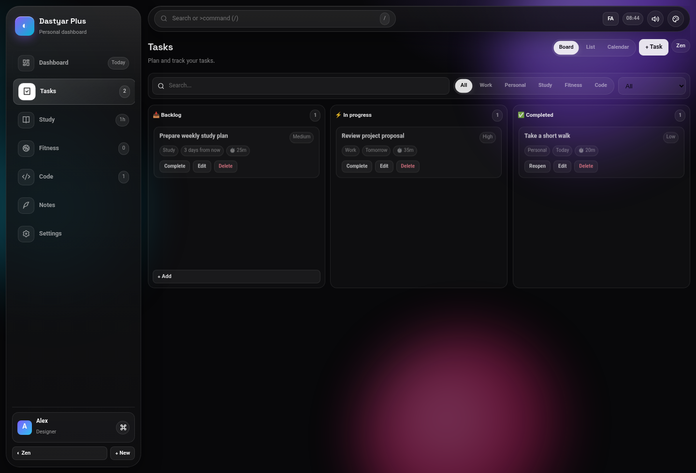
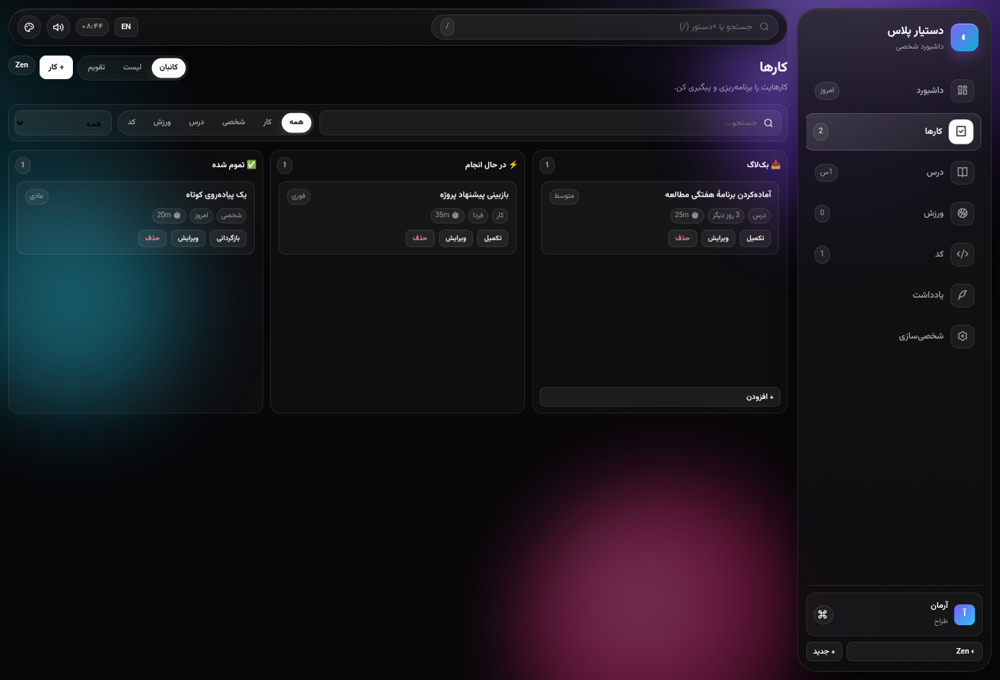
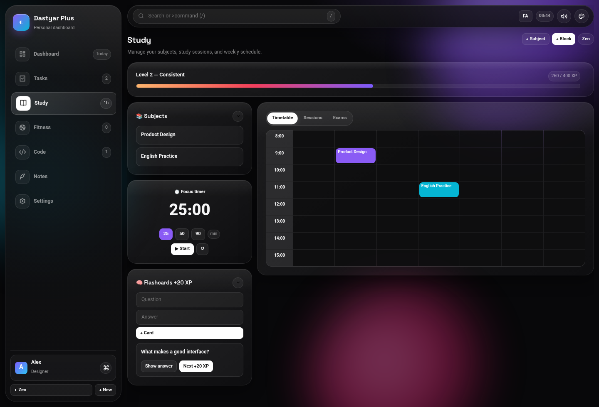

<div align="center">

# Dastyar Plus

### One calm workspace for your day.

A bilingual personal dashboard for tasks, study, fitness, coding, and notes. Runs as a static site; your workspace stays in your browser.

[**فارسی**](README.fa.md) · [Installation & deployment](DEPLOYMENT.md) · [راهنمای نصب و انتشار](DEPLOYMENT.fa.md)


</div>

---

## A quick look

The screenshots below use sample content to show the English and Persian interfaces. They contain no user data.

<div align="center">
  
  <br />
  <sub>Keep tasks moving across backlog, in progress, and completed.</sub>
</div>

<details>
<summary>View the Persian task board</summary>

<div align="center">
  
</div>

</details>

<div align="center">
  
  <br />
  <sub>Plan study time, track sessions, and review flashcards in one place.</sub>
</div>

## What you can do

| Area | Tools |
| --- | --- |
| **Tasks** | Kanban board and list, categories, priorities, due dates, recurring tasks, search, drag-and-drop, and quick edit/complete/delete actions. |
| **Study** | Subjects, weekly timetable, study sessions, exams, flashcards, and 25-, 50-, or 90-minute focus timers. |
| **Fitness** | Workout log and programs, weight tracking, and before/after progress photos. |
| **Coding** | Project and snippet lists, a focus timer, and an optional Monaco editor. |
| **Notes** | Folders, live search, and Markdown preview. |
| **Personal dashboard** | Profile details, rearrangeable widgets, themes, and progress indicators. |
| **Find things fast** | Search tasks, notes, subjects, and projects from the command palette. Press `Ctrl+K` / `⌘K`, press `/`, or enter a search term in the top search field. |

## Start using it

No build step, package manager, account, or backend is required.

1. Download or clone the repository.
2. Open `index.html`, or serve the project root locally:

   ```bash
   python3 -m http.server 8000
   ```

3. Visit <http://localhost:8000>.
4. Set your display name, role, goal, and preferred language in **Settings**.

## Publish with GitHub Pages

Dastyar Plus can be hosted as a static site:

1. Push the project to a GitHub repository.
2. Open **Settings → Pages**.
3. Under **Build and deployment**, choose **Deploy from a branch**, select `main` and `/(root)`, and save.

See the [full deployment guide](DEPLOYMENT.md) for repository setup, browser upload, privacy notes, and troubleshooting. The [Persian guide](DEPLOYMENT.fa.md) is also available.

## Privacy and storage

There is no app server or account system. Profile details and dashboard data are saved in `localStorage` in the current browser; they do not sync automatically between browsers or devices. Export a JSON backup from **Settings → Data → Export** before clearing browser data or moving devices. Treat backup files as private and only import files from sources you trust.

The browser controls how much local storage is available. Progress photos are resized before saving. Fonts, icons, and the optional Monaco editor may load from third-party CDNs when online; fallback fonts keep the core interface usable without them.

## Project layout

```text
index.html                 Application markup
css/style.css              Layout, themes, and responsive styles
js/app.js                  App state, language support, and interactions
docs/images/                README screenshots made with sample data
README.md                  This page
README.fa.md               Persian overview
DEPLOYMENT.md               English installation and publishing guide
DEPLOYMENT.fa.md            Persian installation and publishing guide
LICENSE                     MIT license
```

## Contributing

Issues and pull requests are welcome. Keep the app dependency-light, preserve both Persian RTL and English LTR layouts, and do not commit personal information or exported workspace backups.

## License

MIT. See [LICENSE](LICENSE).
